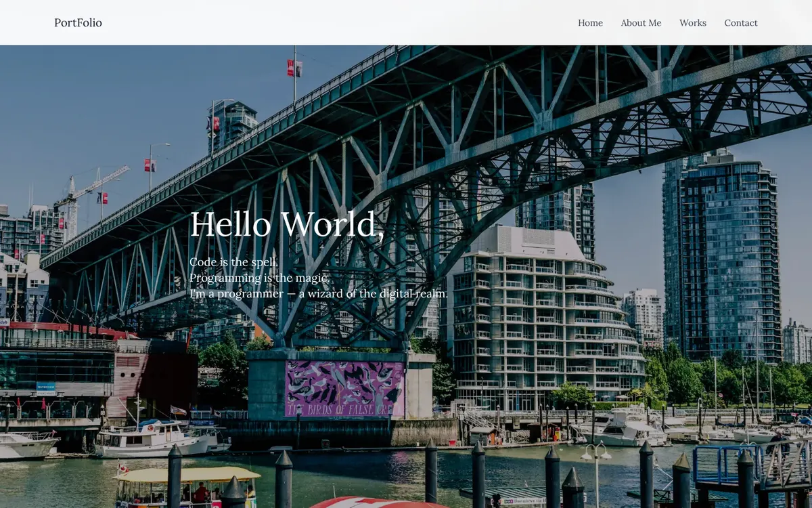
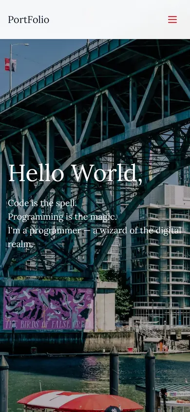

# Portfolio v2

[](https://github.com/mizu20040814/portfolio-v2/actions/workflows/ci.yml)

Mizuki の個人ポートフォリオサイトです。プロフィール、スキル、制作物、連絡先を載せています。

**サイト:** https://portfolio-v2-mizu2s-projects-22f926d0.vercel.app/

<p>
  
  
</p>

## 技術スタック

| 分類 | 使っているもの |
| --- | --- |
| フレームワーク | Next.js 16（App Router）、React 19 |
| 言語 | TypeScript（strict） |
| スタイル | Tailwind CSS v4、CSS（`src/app/globals.css`） |
| フォント | `next/font`（Lora） |
| 画像 | WebP（`sharp` で変換）、`next/image` |
| 品質チェック | ESLint（eslint-config-next）、`tsc --noEmit`、GitHub Actions |
| ホスティング | Vercel（`main` への push で自動デプロイ） |

## 工夫した点

- **全ページを静的生成** しています。サーバーの処理を待たずに表示され、Vercel の無料枠で運用できます。
- **表示速度**: ヒーロー画像を `fetchPriority="high"` で先読みし、画像は WebP に変換して軽くしています。見出しのアニメーションは JavaScript を使わず CSS だけで動かしています。
- **アクセシビリティ**: 見出しの階層、ボタンのラベル、文字と背景のコントラストを整えています。OS で「視差効果を減らす」を設定している人にはアニメーションを控えめにします。
- **SEO**: ページごとの metadata、OGP 画像、`sitemap.xml`、`robots.txt` を用意しています。
- **技術アイコン** は CDN を使わず、SVG を `public/icons/` に置いて配信しています。

## ディレクトリ構成

```
src/
├── app/            # ページ（/, /about, /works, /contact）と metadata、sitemap、robots
├── components/     # home / about / layout / ui ごとのコンポーネント
├── data/           # 作品（works.ts）とスキル（skills.ts）のデータ
├── lib/site.ts     # サイトの URL
└── types/          # 型定義
public/
├── images/         # 写真（WebP）と OGP 画像
└── icons/          # 技術アイコン（SVG）
scripts/
└── optimize-images.mjs  # public/images の jpg/png を WebP に変換
```

作品やスキルを追加するときは `src/data/works.ts`、`src/data/skills.ts` を編集します。

## ローカルで動かす

Node.js 20.9 以上（CI は Node.js 22）が必要です。

```bash
npm ci
npm run dev      # http://localhost:3000
```

| コマンド | 内容 |
| --- | --- |
| `npm run dev` | 開発サーバーを起動 |
| `npm run build` | 本番用にビルド |
| `npm run start` | ビルドしたものを起動 |
| `npm run lint` | ESLint |
| `npm run typecheck` | TypeScript の型チェック（`tsc --noEmit`） |
| `npm run optimize-images` | `public/images` の jpg/png を WebP に変換 |

サイトの URL を変えるときは、環境変数 `NEXT_PUBLIC_SITE_URL` を設定します（未設定なら `src/lib/site.ts` の URL を使います）。

## CI

Pull Request と `main` への push のたびに、GitHub Actions（`.github/workflows/ci.yml`）で次の3つを実行します。

1. `npm run lint`
2. `npm run typecheck`
3. `npm run build`
